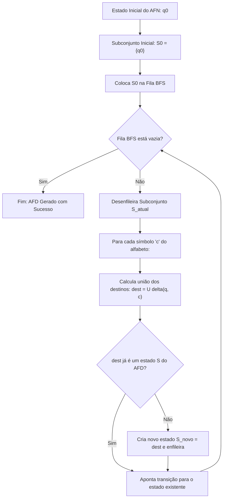

# Documentação: Conversor de AFN para AFD

Este documento explica em detalhes a arquitetura, as estruturas de dados, o tipo de leitura implementado e o algoritmo de conversão de **Autômato Finito Não-Determinístico (AFN)** para **Autômato Finito Determinístico (AFD)**.

---

## 📌 Sumário
1. [Visão Geral e Fundamentação Teórica](#1-visão-geral-e-fundamentação-teórica)
2. [Padrão de Leitura Implementado](#2-padrão-de-leitura-implementado)
   - [Leitura por Arquivo `.txt`](#leitura-por-arquivo-txt)
   - [Leitura Interativa via Teclado](#leitura-interativa-via-teclado)
3. [Estruturas de Dados e Máscaras de Bits](#3-estruturas-de-dados-e-máscaras-de-bits)
4. [Como Funciona o Algoritmo de Conversão (BFS)](#4-como-funciona-o-algoritmo-de-conversão-bfs)
5. [Simulação de Cadeias e Exportação](#5-simulação-de-cadeias-e-exportação)
6. [Exemplo Prático Passo a Passo](#6-exemplo-prático-passo-a-passo)
7. [Como Compilar e Executar](#7-como-compilar-e-executar)

---

## 1. Visão Geral e Fundamentação Teórica

Um **AFN** permite que, a partir de um estado e de um determinado símbolo, haja:
- Zero transições (vazio / transição indefinida);
- Uma transição;
- **Duas ou mais transições para estados diferentes**.

Já um **AFD** exige determinismo estrito: para cada estado e cada símbolo do alfabeto, há no máximo uma transição bem definida.

A conversão é realizada pelo **Algoritmo de Construção de Subconjuntos** (*Powerset / Subset Construction*), onde:
- Cada estado do AFD corresponde a um **conjunto de estados do AFN**.
- O estado inicial do AFD é o conjunto `{q_inicial}`.
- Um estado do AFD é considerado **final** se contiver pelo menos um estado final do AFN.
- A busca é realizada em largura (**BFS - Breadth-First Search**) para explorar e criar apenas os subconjuntos alcançáveis.



---

## 2. Padrão de Leitura Implementado

O módulo foi adaptado para respeitar rigorosamente o padrão de leitura unificado do projeto (`afd.h` / `afd.c` / `ex_leitura.txt`), oferecendo duas modalidades.

### Leitura por Arquivo `.txt`
A função `lerAFNArquivo(const char *nome, AFN *a)` lê o arquivo conforme o padrão:

1. **Linha 1:** `<qtd_estados> <tamanho_alfabeto>` (ex: `3 2`)
2. **Linha 2:** Símbolos do alfabeto separados por espaço (ex: `a b`)
3. **Linha 3:** Estado inicial (ex: `0`)
4. **Linha 4:** `<qtd_finais> <final_1> <final_2> ...` (ex: `1 2`)
5. **Linhas seguintes:** Transições `<origem> <simbolo> <destino>` até o fim do arquivo.

#### Exemplo de arquivo (`exemplo_afn_ab.txt`):
```text
3 2
a b
0
1 2
0 a 0
0 a 1
0 b 0
1 b 2
```

> **Flexibilidade implementada:**
> - Linhas em branco e comentários iniciados com `#` ou `//` são automaticamente ignorados.
> - Suporta tanto transições unitárias (`0 a 0` seguido de `0 a 1`) quanto múltiplos destinos na mesma linha (`0 a 0 1`).

---

### Leitura Interativa via Teclado
A função `lerAFN(AFN *a)` solicita os dados interativamente no terminal, com mensagens idênticas às de `lerAFD`:
```text
Quantidade de estados (estados serao 0..n-1): 3
Tamanho do alfabeto: 2
Simbolos (separados por espaco): a b
Estado inicial: 0
Quantidade de estados finais: 1
Estados finais: 2
Quantidade de transicoes: 4
Digite cada transicao como: origem simbolo destino (ex: 0 a 1)
Transicao 1: 0 a 0
Transicao 2: 0 a 1
Transicao 3: 0 b 0
Transicao 4: 1 b 2
```

---

## 3. Estruturas de Dados e Máscaras de Bits

Para obter máxima eficiência e evitar o conflito de tipos com `afd.h`, o projeto utiliza a estrutura padrão `AFD` e introduz a estrutura `AFN`:

### Estrutura `AFN` (`conversor_AFN_para_AFD.h`)
```c
typedef struct {
  int n;                                       /* Quantidade de estados (0..n-1) */
  int m;                                       /* Tamanho do alfabeto */
  char alfabeto[MAX_SIMBOLOS];                 /* Símbolos do alfabeto */
  int inicial;                                 /* Estado inicial */
  int final[MAX_ESTADOS];                      /* final[i] = 1 se 'i' é final */
  uint64_t finais_mask;                        /* Máscara de bits com os estados finais */
  uint64_t trans[MAX_ESTADOS][MAX_SIMBOLOS];   /* trans[origem][simbolo] = máscara de destinos */
} AFN;
```

### Por que Máscaras de Bits (`uint64_t`)?
Em vez de manipular listas dinâmicas de estados para cada transição:
- O estado `qk` é representado pelo bit `k` ligado: `(1ULL << k)`.
- O conjunto `{q0, q1}` é simplesmente o valor numérico `(1ULL << 0) | (1ULL << 1) = 3`.
- A união de conjuntos de destinos é feita instantaneamente com a operação bitwise OR: `dest_mask |= afn->trans[e][simbolo]`.
- A verificação de aceitação é feita em tempo constante: `(dest_mask & afn->finais_mask) != 0`.

### Estrutura `AFD` (`afd.h`)
O AFD gerado pelo conversor é preenchido diretamente na struct oficial do projeto:
```c
typedef struct {
  int n;                                /* Quantidade de estados no AFD gerado */
  int m;                                /* Tamanho do alfabeto */
  char alfabeto[MAX_SIMBOLOS];          /* Símbolos */
  int inicial;                          /* Estado inicial (sempre 0 / S0) */
  int final[MAX_ESTADOS];               /* final[i] = 1 se Si for final */
  int delta[MAX_ESTADOS][MAX_SIMBOLOS]; /* Matriz de transição determinística */
} AFD;
```
> Isso garante que o AFD gerado possa ser impresso por `imprimirAFD()`, minimizado diretamente por `minimizarAFD()` e salvo no formato oficial do simulador.

---

## 4. Como Funciona o Algoritmo de Conversão (BFS)

A função principal é `converter_afn_para_afd_subconjuntos(const AFN *afn, AFD *dfa, uint64_t *subconjuntos)`:

1. **Inicialização do Estado S0:**
   - O subconjunto inicial contém apenas o estado inicial do AFN: `sub[0] = (1ULL << afn->inicial)`.
   - Define `dfa->n = 1` e `dfa->inicial = 0`.
   - Se `sub[0]` intercepta os estados finais do AFN, marca `dfa->final[0] = 1`.
   - Adiciona o índice `0` à fila da BFS (`fila[0] = 0`).

2. **Laço de Exploração (BFS):**
   - Enquanto houver estados na fila:
     - Retira o estado `u` da fila e recupera sua máscara `mask_u = sub[u]`.
     - Para cada símbolo `j` do alfabeto:
       1. **Calcula o Destino:**
          Percorre todos os estados `e` presentes em `mask_u`. Se o bit `e` estiver ativo, acumula os destinos:
          ```c
          dest_mask |= afn->trans[e][j];
          ```
       2. **Tratamento de Transição Vazia:**
          Se `dest_mask == 0` (nenhum estado de destino), registra `dfa->delta[u][j] = -1` (estado morto / transição inexistente).
       3. **Busca por Estado Existente:**
          Varre os estados já descobertos `0 .. dfa->n - 1`. Se existir algum `k` tal que `sub[k] == dest_mask`, reaproveita o índice:
          ```c
          idx_existente = k;
          ```
       4. **Criação de Novo Estado:**
          Se o subconjunto nunca foi visto antes:
          - Atribui o novo ID determinístico: `idx_existente = dfa->n++`.
          - Salva a máscara: `sub[idx_existente] = dest_mask`.
          - Define se é final: `dfa->final[idx_existente] = ((dest_mask & afn->finais_mask) != 0)`.
          - Insere o novo índice no fim da fila BFS para ser explorado.
       5. **Conexão da Transição:**
          ```c
          dfa->delta[u][j] = idx_existente;
          ```

---

## 5. Simulação de Cadeias e Exportação

### Simulação de Palavras (`simular_cadeia_afd`)
Permite testar cadeias de caracteres no AFD resultante:
1. Começa no estado inicial `S0`.
2. Para cada caractere da cadeia:
   - Valida se o caractere pertence ao alfabeto.
   - Consulta a transição `proximo = dfa->delta[atual][idx]`.
   - Se `proximo == -1`, rejeita imediatamente (caiu em estado morto).
   - Mostra no terminal o passo a passo com o subconjunto correspondente:
     ```text
     Passo 1: S0 --('a')--> S1 {q0,q1}
     Passo 2: S1 --('b')--> S2 {q0,q2}
     ```
3. No final da cadeia, verifica se `dfa->final[atual] == 1`:
   - **ACEITA:** se o estado final atingido for de aceitação.
   - **REJEITADA:** caso contrário.

### Exportação para Arquivo (`salvarAFDArquivo`)
Gera um arquivo `.txt` contendo exatamente a especificação de entrada do projeto:
```text
3 2
a b
0
1 2
0 a 1
0 b 0
1 a 1
1 b 2
2 a 1
2 b 0
```
Esse arquivo pode ser aberto por qualquer função do sistema, inclusive a opção de **Minimização de AFD**.

---

## 6. Exemplo Prático Passo a Passo

Considere o AFN que aceita palavras sobre `{a, b}` terminadas em `"ab"`:
- **Estados:** `q0, q1, q2`
- **Inicial:** `q0`
- **Final:** `q2`
- **Transições:**
  - `delta(q0, a) = {q0, q1}`
  - `delta(q0, b) = {q0}`
  - `delta(q1, b) = {q2}`

### Passo a passo da Conversão:

1. **Estado Inicial:**
   - `S0 = {q0}` (Não-final)

2. **Explorando S0 com 'a' e 'b':**
   - `delta(S0, a) = delta(q0, a) = {q0, q1}` ➡️ Novo estado: `S1 = {q0, q1}`
   - `delta(S0, b) = delta(q0, b) = {q0}` ➡️ Estado existente: `S0`

3. **Explorando S1 com 'a' e 'b':**
   - `delta(S1, a) = delta(q0, a) U delta(q1, a) = {q0, q1} U {} = {q0, q1}` ➡️ Estado existente: `S1`
   - `delta(S1, b) = delta(q0, b) U delta(q1, b) = {q0} U {q2} = {q0, q2}` ➡️ Novo estado: `S2 = {q0, q2}` (Final, pois contém `q2`)

4. **Explorando S2 com 'a' e 'b':**
   - `delta(S2, a) = delta(q0, a) U delta(q2, a) = {q0, q1} U {} = {q0, q1}` ➡️ Estado existente: `S1`
   - `delta(S2, b) = delta(q0, b) U delta(q2, b) = {q0} U {} = {q0}` ➡️ Estado existente: `S0`

### Tabela Resultante do AFD:
| Estado | Subconjunto AFN | 'a' | 'b' | Final? |
| :---: | :---: | :---: | :---: | :---: |
| **-> S0** | `{q0}` | S1 | S0 | NÃO |
| **S1** | `{q0, q1}` | S1 | S2 | NÃO |
| *** S2** | `{q0, q2}` | S1 | S0 | **SIM** |

---

## 7. Como Compilar e Executar

### Compilação:
```bash
gcc -Wall -Wextra main.c afd.c minimizar_afd.c commons.c conversor_AFN_para_AFD.c -o exe
```

### Execução:
```bash
./exe
```

### Navegação no Menu:
No menu principal, selecione a **Opção 1**:
```text
----Menu----
Escolha seu algoritmo:
1-Converter AFN para AFD
2-TODO
3-TODO
4-Minimizar AFD
0-Sair
Digite o número: 1
```

Em seguida:
1. Escolha **1** para digitar o AFN ou **2** para carregar um arquivo `.txt` (como `exemplo_afn_ab.txt`).
2. O sistema exibirá a tabela do AFN e a tabela do AFD determinizado com todos os subconjuntos mapeados.
3. Utilize o submenu para testar cadeias (ex: `ab`, `aab`, `bab`), salvar o arquivo `.txt` ou minimizar o autômato resultante!
